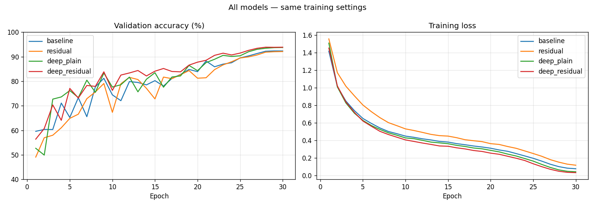
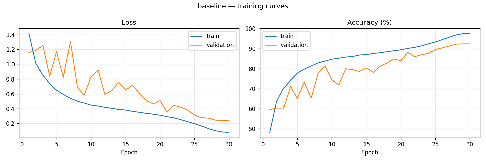
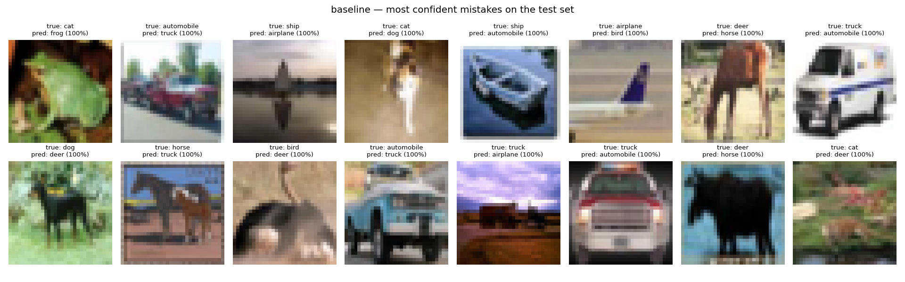
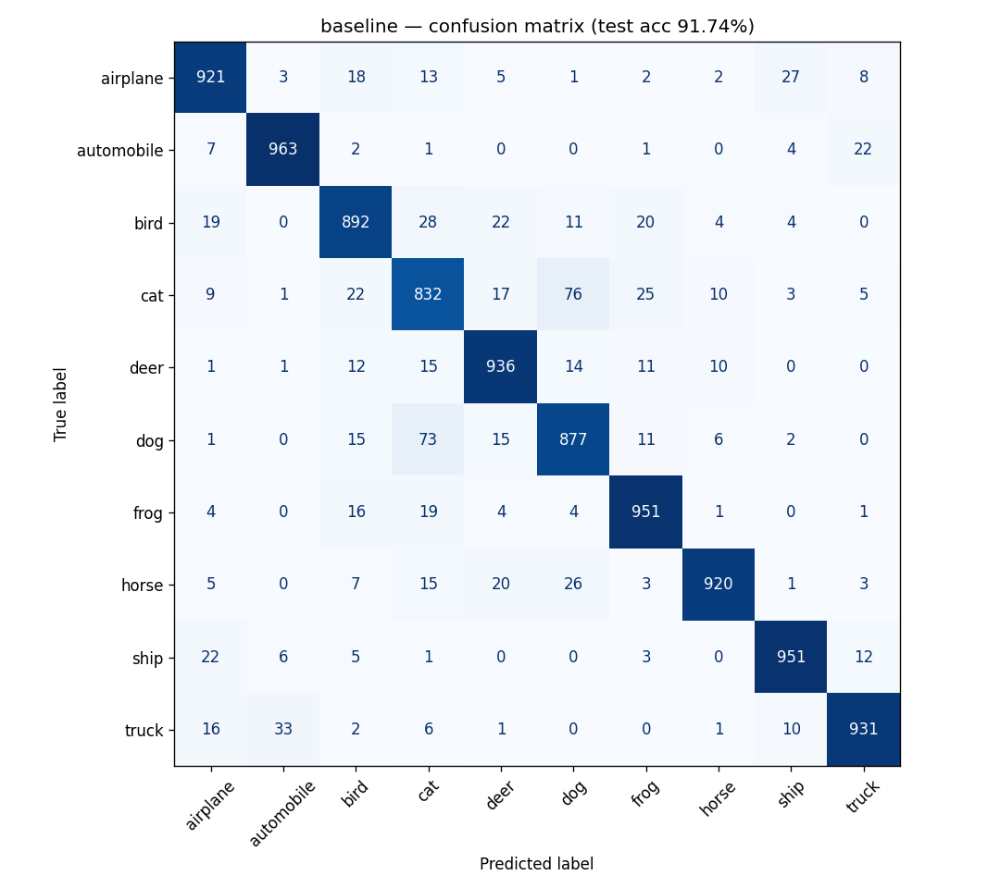

# CIFAR-10 Image Classification (PyTorch, from scratch)

A small CNN built from scratch in PyTorch to classify CIFAR-10 images (10 classes, 32×32 pixels),
plus a residual-block improvement (Part 2, Option A) and a controlled depth experiment.

**Best model:** `deep_residual` — **93.21% test accuracy** (93.88% validation).
**Baseline (Part 1):** **91.74% test accuracy** (92.36% validation).

---

## Brief checklist

| Requirement | Where |
|---|---|
| Load CIFAR-10, normalize, augment, batch, `DataLoader` | `src/data.py` |
| Small CNN from scratch: conv, BatchNorm, Dropout, classification head | `src/models.py` → `BaselineCNN` |
| Training loop: loss, accuracy, LR scheduling, checkpoints | `src/train.py` |
| Loss & accuracy curves | `outputs/<model>/curves.png` |
| Test accuracy | `src/evaluate.py` → `outputs/<model>/metrics.json` |
| Misclassified images | `outputs/<model>/misclassified.png` |
| Random seeds | `src/utils.py` → `set_seed()`, `seed_worker()`, `get_generator()` |
| Requirements file | `requirements.txt` |
| Part 2, Option A: residual block | `src/models.py` → `ResidualBlock`, `ResidualCNN`, `DeepCNN` |
| Baseline vs improved comparison | `src/compare.py` → `outputs/comparison.md` |
| Optional: mixed precision | `src/train.py` (AMP on GPU) |
| Optional: unit tests | `tests/test_models.py` (14 tests) |
| Optional: ONNX export + inference | `src/export_onnx.py` |
| Extra: experiment tracking | MLflow (`mlruns/mlflow.db`) |

---

## Project structure

```
task1_cifar10_classifier/
├── README.md
├── requirements.txt
├── .gitignore
├── cifar10_runner.ipynb       # Colab notebook that runs every step, with outputs
├── src/
│   ├── config.py              # all settings in one place
│   ├── utils.py               # seeds, checkpoint save/load, plotting
│   ├── data.py                # dataset, train/val split, transforms, DataLoaders
│   ├── models.py              # BaselineCNN, ResidualBlock, ResidualCNN, PlainBlock, DeepCNN
│   ├── train.py               # training loop + checkpoints + MLflow logging
│   ├── evaluate.py            # test accuracy, confusion matrix, misclassified images
│   ├── compare.py             # comparison table + overlay plot for all models
│   └── export_onnx.py         # ONNX export + check against PyTorch
├── tests/
│   └── test_models.py         # unit tests (pytest)
├── checkpoints/
│   ├── best_<model>.pt        # best checkpoint per model (chosen by validation accuracy)
│   └── deep_residual.onnx     # ONNX version of the best model
├── outputs/
│   ├── <model>/               # history.csv, curves.png, metrics.json,
│   │                          # confusion_matrix.png, misclassified.png
│   ├── sample_images.png      # augmented training samples
│   ├── comparison.md          # all-model comparison table
│   ├── comparison_curves.png  # all-model curves
│   └── onnx_check.json        # ONNX vs PyTorch check
└── mlruns/                    # MLflow tracking database + artifacts
```

The dataset is not included. It downloads automatically to `data/` on the first run.

---

## How to run

Run all commands from the project root.

```bash
pip install -r requirements.txt

# 1. Unit tests (CPU, ~10 s, no dataset needed)
python -m pytest tests -v

# 2. Train (downloads CIFAR-10 on first run)
python -m src.train --model baseline          # Part 1
python -m src.train --model residual          # Part 2
python -m src.train --model deep_plain        # depth experiment (no shortcuts)
python -m src.train --model deep_residual     # depth experiment (with shortcuts)
python -m src.train --model baseline --epochs 2   # quick smoke test

# 3. Evaluate on the test set (uses checkpoints/best_<model>.pt)
python -m src.evaluate --model baseline

# 4. Compare all models
python -m src.compare

# 5. Export the best model to ONNX and check it matches PyTorch
python -m src.export_onnx --model deep_residual

# 6. (Optional) Browse experiments in the MLflow UI
mlflow ui --backend-store-uri sqlite:///mlruns/mlflow.db
```

- The `best_*.pt` checkpoints are included, so steps 3–5 work **without retraining**.
- Model names: `baseline`, `residual`, `deep_plain`, `deep_residual`.
- **On Colab:** open `cifar10_runner.ipynb`, set Runtime → T4 GPU, run the Setup cell, then run the cells in order.
- **Without a GPU** the code still runs (mixed precision switches off automatically), but one 30-epoch run takes hours instead of ~10 minutes.

---

## Training setup

| Setting | Value |
|---|---|
| Data split | 45,000 train / 5,000 validation (seeded split of the 50k training set) / 10,000 test |
| Augmentation (train only) | RandomCrop(32, padding=4), RandomHorizontalFlip |
| Normalization | CIFAR-10 per-channel mean (0.4914, 0.4822, 0.4465) and std (0.2470, 0.2435, 0.2616) |
| Batch size | 128 (352 batches per epoch) |
| Epochs | 30 |
| Loss | CrossEntropyLoss |
| Optimizer | SGD, momentum 0.9, Nesterov, weight decay 5e-4 |
| LR schedule | OneCycleLR, peak LR 0.1, updated every batch |
| Dropout | 0.3 (before the final linear layer) |
| Mixed precision | AMP (torch.autocast + GradScaler) on GPU |
| Seed | 42 (Python, NumPy, PyTorch, CUDA, DataLoader workers and shuffle) |
| Checkpoints | `last_<model>.pt` every epoch, `best_<model>.pt` when validation accuracy improves |
| Hardware | Google Colab, NVIDIA Tesla T4, Python 3.13.15, PyTorch 2.11.0 |

The **test set is used only in `evaluate.py`**, once per model, after training. All choices (best epoch, which model to export) use validation accuracy only.

---

## Model design decisions

**Baseline (`BaselineCNN`, 1,148,874 parameters)**
- 3 stages of `[Conv3x3 → BatchNorm → ReLU] × 2 → MaxPool`, with channels 64 → 128 → 256 and image size 32 → 16 → 8 → 4.
- Head: global average pooling → Dropout(0.3) → Linear(256, 10).
- **Why:** a small VGG-style network is a strong, simple baseline for 32×32 images. Two 3×3 convs per stage see the same area as one 5×5 conv with fewer parameters.
- **BatchNorm** after every conv keeps activations stable and allows a high learning rate (0.1).
- **`bias=False`** in convs, because the BatchNorm right after already adds a learned shift.
- **Global average pooling** instead of large fully connected layers: almost no parameters in the head and less overfitting.
- **Dropout only in the head**: augmentation and BatchNorm already regularize the conv layers.
- Built from scratch on purpose (the brief forbids pre-trained models). In a real project, a pre-trained model with fine-tuning would usually reach higher accuracy faster.

**Residual block (`ResidualBlock`)**
- `out = ReLU( BN(conv(ReLU(BN(conv(x))))) + shortcut(x) )`
- The shortcut is the identity when the shape stays the same, and a 1×1 conv + BatchNorm when the size or channels change (stride 2).

**Residual model (`ResidualCNN`, 1,227,594 parameters):** stem conv (64) → 3 residual blocks (64, 128 stride 2, 256 stride 2) → same head. Similar size to the baseline (+6.9% parameters).

**Depth experiment (`DeepCNN`):** stem + 3 stages × 2 blocks = 13 conv layers, built either with `PlainBlock` (**no** shortcut, 2,735,946 parameters) or `ResidualBlock` (**with** shortcut, 2,777,674 parameters). Same depth, same size, same settings: the only difference is the shortcut. This is the controlled test of the residual idea.

**Training choices**
- **Validation split**: 5,000 training images are held out to pick the best epoch, so the test score stays an honest estimate.
- **OneCycle + SGD (Nesterov)**: LR warms up to 0.1 in the first ~30% of training, then decays to near 0. This trains fast in a fixed budget, and the final low-LR phase gives most of the last accuracy gains.
- **AMP** speeds up training on the T4 GPU.
- **Deterministic cuDNN** (`deterministic=True, benchmark=False`): slightly slower, but runs are repeatable.
- **MLflow with a SQLite backend**: MLflow 3.x no longer accepts the old folder-based store. Logging is wrapped so a tracking error can never stop training.

---

## Results

All models: same data split, seed 42, optimizer, schedule, batch size and 30 epochs.

| Model | Conv layers | Params | Best epoch | Best val acc | **Test acc** | Train–val gap | High-LR val acc | Sec/epoch |
|---|---|---|---|---|---|---|---|---|
| baseline | 6 | 1,148,874 | 29 | 92.36% | **91.74%** | 5.13 | 78.2% ± 5.1 | 17.0 |
| residual | 7 | 1,227,594 | 30 | 92.12% | **91.06%** | 4.29 | 77.6% ± 5.5 | 18.2 |
| deep_plain | 13 | 2,735,946 | 30 | 93.76% | **93.00%** | 5.02 | 80.2% ± 3.7 | 20.5 |
| deep_residual | 13 | 2,777,674 | 28 | 93.88% | **93.21%** | 4.68 | 82.2% ± 4.0 | 20.6 |

- *Train–val gap*: train accuracy minus validation accuracy at the best epoch (train accuracy is measured with augmentation and dropout on).
- *High-LR val acc*: mean ± std of validation accuracy in epochs 6–20, where the LR is at least 50% of its peak.
- Full table: `outputs/comparison.md`.



### Baseline (Part 1)
- **Test accuracy 91.74%** (9,174 / 10,000), within 0.62 points of validation (92.36%), so there is no overfitting to the validation set.
- Validation accuracy was noisy in the high-LR phase and rose steadily as OneCycle lowered the LR. The best epoch was 29.



### Part 2: does the residual block help?
**Controlled comparison (13 layers, with vs without shortcuts):**
- Final accuracy was almost the same: deep_residual is **+0.12 points on validation** and **+0.21 points on test** (21 images out of 10,000). This is too small to call a real improvement from one run.
- Shortcuts made the network **learn faster**: validation accuracy was **about 2.0 points higher** on average during the high-LR phase (82.2% vs 80.2%), and training loss was lower from epoch 5 to the end (final 0.034 vs 0.044). The spread of validation accuracy was similar (± 4.0 vs ± 3.7), so training was not clearly *more stable*, just faster.

**Same-size comparison (baseline vs residual):**
- The residual model did **not** improve on the baseline (val 92.12% vs 92.36%, test 91.06% vs 91.74%), and its training loss was higher throughout.
- This comparison does not isolate the shortcut: the residual model also downsamples with stride-2 convs instead of MaxPool, has 7 instead of 6 conv layers, and pools from 8×8 instead of 4×4.

**Depth gave the largest gain:** going from 6 to 13 conv layers improved test accuracy by **+1.26 points** (plain) and **+1.47 points** (residual) over the baseline, for about 20% more time per epoch.

**Conclusion:** at 7–13 layers, residual connections speed up learning but do not change final accuracy much. Their main benefit, training much deeper networks (20–50+ layers) that plain networks struggle with, is beyond the scale of this task.

### Error analysis (baseline)
- Hardest classes: **cat (83.2%)**, dog (87.7%), bird (89.2%). Easiest: automobile (96.3%), ship and frog (95.1%).
- **Cat ↔ dog** is the biggest confusion: 76 + 73 = **149 of 826 errors (18%)**. Similar shape, fur and poses at 32×32 pixels.
- Other common mistakes: truck → automobile (33), bird → cat (28), airplane → ship (27; both often on a plain blue background).
- Animals are almost never confused with vehicles. Errors are mostly within these two groups.
- The most confident mistake for both the baseline and the residual model is a test image **labelled "cat" that appears to show a frog**. It is likely a label error in the dataset itself.




### Optional extensions
- **Unit tests:** 14 tests pass in ~8 s (output shapes, exact parameter counts, residual block shapes and shortcut type, seed reproducibility, loss decreases with training, transforms and normalization).
- **ONNX:** `deep_residual.onnx` (11.1 MB) passes `onnx.checker`. On 1,024 test images, ONNX Runtime matches PyTorch: max logit difference **5.7e-06**, **100% same predictions**, identical accuracy. CPU speed **~8.4 ms per image**. Exported with the TorchScript-based exporter. The newer `torch.export` exporter is a fallback in the code.
- **Mixed precision:** AMP on GPU during training.
- **MLflow:** every run (settings, per-epoch metrics, curves, summaries) is logged to `mlruns/mlflow.db`.

---

## Reproducibility

- Seeds are fixed for Python, NumPy, PyTorch, CUDA, DataLoader workers and shuffle order, with deterministic cuDNN.
- Two separate 2-epoch runs of the baseline gave **identical** losses and accuracies at every epoch.
- The residual model was trained twice by accident. Both runs gave **identical** results (92.12% validation at epoch 30), as shown in MLflow.
- Exact library versions are in `requirements.txt`. Results can differ slightly on a different GPU or library version.

---

## Limitations and next steps

- **Single seed per model.** Differences under ~0.5 points (e.g. deep_residual vs deep_plain) are within normal seed-to-seed variation. Next step: 3–5 seeds per model and report mean ± std.
- **Overconfident mistakes.** The most confident errors have ≥99% confidence. Next step: temperature scaling (post-hoc, no retraining) or label smoothing.
- **Mild overfitting** (train–val gap of 4–5 points at the end). Stronger augmentation (Cutout, AutoAugment) or longer training could help.
- **Residual benefit at greater depth was not tested.** Next step: compare plain vs residual at 20+ layers.
- **Deployment:** the ONNX model is ready to serve. A FastAPI `/predict` endpoint loading it with ONNX Runtime would be the next step.
